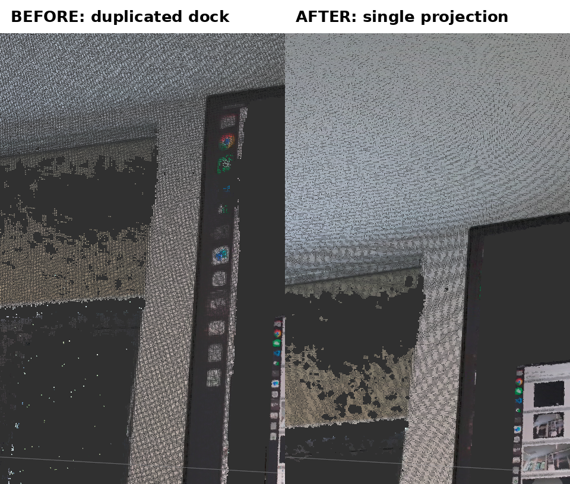
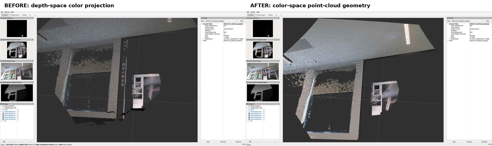

# 彩色点云的坐标系与遮挡处理

## 问题与原因

Azure Kinect 的 Color 与 Depth 相机存在物理基线，两者看到的遮挡边界并不完全相同。旧版点云
以 Depth 相机的像素和坐标生成 XYZ，再将 Color 图像重投影到 Depth 像素。显示器边缘等前后景
深度突变处，Color 相机可见的前景像素可能因此被分配给 Depth 相机看到的后方墙面点，表现为
显示器内容同时出现在显示器和墙面上。

这不是 RViz 的 `Decay Time` 累积或 TF 重复发布，而是将 Color 纹理映射到 Depth 几何时的
可见性歧义。`/k4a/aligned_color_to_depth/image_raw` 本身仍可能在遮挡边界出现这类拉伸或重影；
该 topic 表示 Color→Depth 重投影结果，保留用于需要 Depth 像素网格的消费者，但不再作为点云
颜色来源。

## 修复方案

启用 RGB 时，点云采用 Color 相机的可见性和像素网格：

1. 使用 `k4a_transformation_depth_image_to_color_camera()` 将 Depth 转换到 Color 相机网格；
2. 使用 `k4a_transformation_depth_image_to_point_cloud()` 和
   `K4A_CALIBRATION_TYPE_COLOR` 生成 Color optical frame 下的 XYZ；
3. 将 XYZ 与同坐标的原始 BGRA Color 像素直接配对，生成 organized XYZRGB 点云。

这条路径让几何与颜色共享 Color 相机的像素、视角和遮挡关系，避免把显示器前景纹理复制到
墙面几何。关闭 RGB 时无法使用 Color 几何，驱动保持 Depth 网格、Depth optical frame 和黑色
RGB 字段的兼容回退。

默认配置下 `/k4a/points` 的语义变化如下：

| 配置 | 点云尺寸 | `header.frame_id` | RGB 来源 |
|---|---:|---|---|
| `color_enabled: true` | `1280×720` | `k4a_color_camera_optical_frame` | 原始 Color 同像素 |
| `color_enabled: false` | `640×576` | `k4a_depth_camera_optical_frame` | 全零 |

Color 分辨率高于 Depth 时，点云消息的 CPU、内存和 DDS 带宽开销会相应增加。这是获得正确
彩色遮挡关系的必要代价；不需要点云时应设置 `point_cloud_enabled: false`。

## 实机对比

前后对比在相同条件下采集：同一相机机位、同一 RViz 观察视角、同一静态屏幕画面，仅驱动版本不同。

下图按原始像素裁剪显示器左侧遮挡边界。修复前墙面上出现完整的 dock 副本；修复后墙面副本消失。

完整 RViz 窗口对比（右侧 Views 面板可核对观察视角一致）：

修复前后原始数据，每组三幅图来自同一同步 RGB-D capture（Depth 以 16-bit PNG 保存）：

- 修复前：[RViz](images/color-point-cloud-occlusion/before_rviz.png)、
  [Color](images/color-point-cloud-occlusion/before_color.png)、
  [Color→Depth](images/color-point-cloud-occlusion/before_aligned.png)、
  [Depth](images/color-point-cloud-occlusion/before_depth.png)
- 修复后：[RViz](images/color-point-cloud-occlusion/after_rviz.png)、
  [Color](images/color-point-cloud-occlusion/after_color.png)、
  [Color→Depth](images/color-point-cloud-occlusion/after_aligned.png)、
  [Depth](images/color-point-cloud-occlusion/after_depth.png)

修复前 `/k4a/points` 为 `640×576`、`k4a_depth_camera_optical_frame`；修复后为
`1280×720`、`k4a_color_camera_optical_frame`。两个版本的 Color→Depth 原图均保留遮挡边界的
重投影特征，说明修复来自点云几何与着色路径的调整，而非图像后处理。

黑色或高反射屏幕可能让 ToF 深度产生空洞；这种深度缺失与本页修复的错误着色是两个独立问题。
